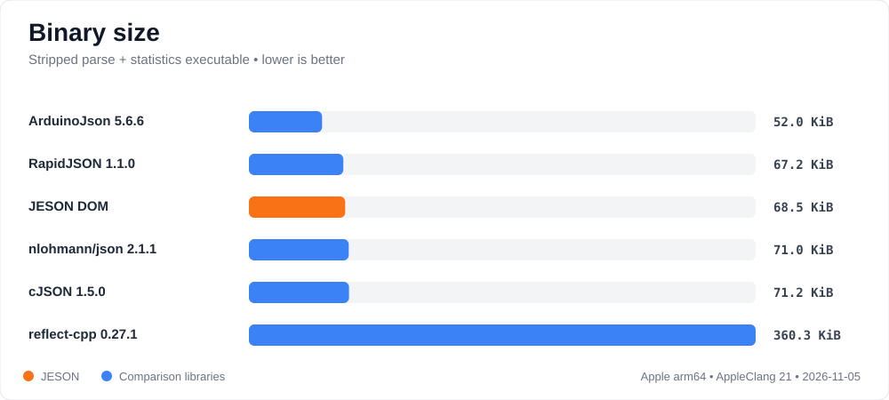
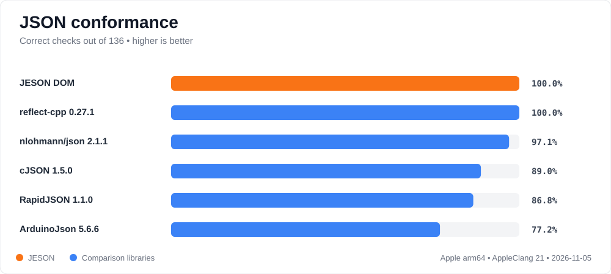
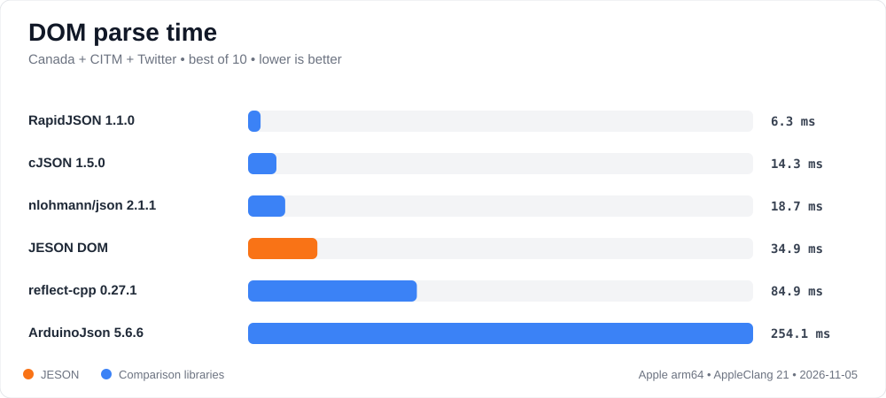
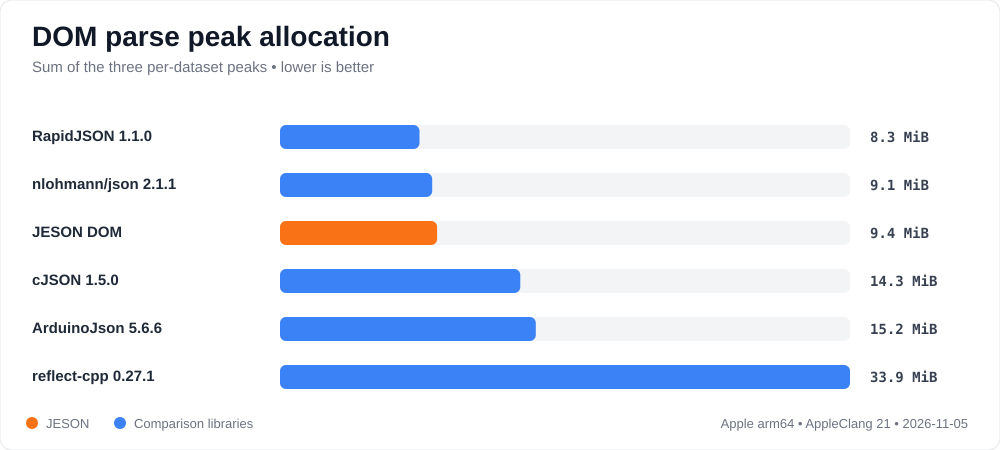
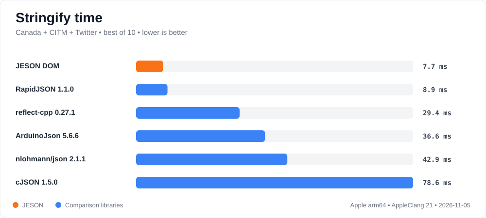
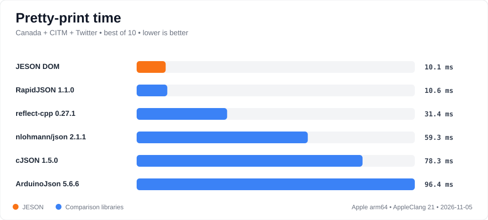

# JESON Native JSON Benchmark

Correctness, speed, memory, and binary-size measurements for
[JESON](https://github.com/mijelsma/jeson), compared with established C and
C++ JSON libraries. The project asks an embedded question: how much correctness
and convenience can fit into limited flash and RAM? This is a JESON-maintained
fork of Milo Yip's
[nativejson-benchmark](https://github.com/miloyip/nativejson-benchmark).

Copyright(c) 2014-2016 Milo Yip (miloyip@gmail.com)

## Introduction

This fork was created to develop JESON for constrained targets—ESP32, Nordic
nRF/Zephyr, and similar devices—against repeatable evidence rather than isolated
microbenchmarks. Its focused build compares JESON with cJSON,
reflect-cpp, RapidJSON, nlohmann/json, and ArduinoJson using the same documents,
operations, allocation tracker, conformance suite, and code-size harness.

Correctness comes first: a fast parser that changes a number, accepts malformed
input, or cannot round-trip a document is not a useful winner. Performance is
then measured as parse/stringify/pretty-print time, memory, allocation count,
and executable size.

The original all-library benchmark remains available below. The root CMake
build and the current charts are the maintained JESON comparison lane.

## Why JESON stands out

JESON is primarily a typed embedded JSON library, not a DOM library. It is
designed for firmware that needs a pleasant interface but cannot casually spend
flash and RAM on layers of generic infrastructure. It parses straight into the
destination aggregate, so normal application code does not need to build a
generic tree and then copy/map it into a model. The optional `jeson::Value` DOM
exists for schema-less documents and is used here only to make nativejson's DOM
operations comparable.

```cpp
enum class Mode { SLEEP, NORMAL, BOOST };

struct Radio {
    jeson::Field<"channel", jeson::Validator<unsigned,
        jeson::Minimum<11>, jeson::Maximum<26>>> channel = 15;
};

struct DeviceConfig {
    jeson::Field<"device_id", jeson::Required<std::string>> deviceId;
    jeson::Field<"radio", Radio> radio;
    jeson::Field<"mode", Mode> mode = Mode::NORMAL;
    jeson::Field<"sample_interval_ms", jeson::Validator<unsigned,
        jeson::Minimum<100>, jeson::Maximum<60000>>> sampleInterval = 1000;
    jeson::Field<"labels", std::vector<std::string>> labels;
};

DeviceConfig config;
auto result = jeson::parse(payload, config); // JSON directly into the model
if (result) {
    config.sampleInterval = 5000;            // ordinary member access
    auto json = jeson::toJson(config);        // same model writes JSON
}
```

### Why the syntax stays easy

- `Field<"wire_name", T>` is the only mapping declaration. The JSON name and
  C++ type cannot drift away in a separate registration table.
- Fields support ordinary assignment, comparison, and nested member access;
  wrapper plumbing does not leak into normal application code.
- C++ initializers are JSON defaults. `Required<T>` makes key presence explicit,
  while `Validator<T, ...>` composes Pydantic-style range and size rules.
- Structs, enums, `std::optional`, and `std::vector` compose naturally, and the
  same aggregate is serialized without a second conversion function.
- Parsing returns accumulated, path-aware errors. Unknown keys can be ignored so
  old and new firmware revisions can exchange configuration safely.
- A `Patch<T>` model supports partial configuration or command updates without
  weakening the requirements of the full model.

Its main strengths are:

- **Typed by default:** direct JSON-to-aggregate parsing without a required DOM
  or separate mapping layer.
- **Correct:** the optional DOM passes all 136 checks in this benchmark,
  including syntax, double conversion, Unicode strings, and round trips.
- **Small:** the stripped DOM benchmark executable is 68.5 KiB—close to
  RapidJSON, and smaller than the pinned nlohmann/json and cJSON builds.
- **Fast output:** JESON has the lowest combined stringify and pretty-print
  time in the checked three-document run.
- **Competitive memory:** combined per-document parse peaks are close to
  RapidJSON and nlohmann/json, and substantially below cJSON and reflect-cpp in
  this run.
- **Embedded-friendly API:** header-only, dependency-free C++20, no runtime
  registration, and no exception-based parse error path.
- **Schema and validation together:** macro-free field names, required values,
  defaults, nested models, enums, optionals, vectors, patches, Pydantic-style
  constraints, and accumulated path-aware errors.
- **Portable integration:** CMake, ESP-IDF, PlatformIO, Arduino, Zephyr, Meson,
  Bazel, Conan, and pkg-config metadata live in the JESON repository.

### How the programming models differ

This is more useful than reading a timing chart alone: the libraries do not ask
the application to write the same kind of code.

| Library | Typical style | Where it is strongest | JESON's trade-off |
|---|---|---|---|
| **JESON** | Typed aggregate, direct parse, optional DOM | Known-schema embedded configuration, commands, and telemetry | Smaller, focused JSON API; requires C++20 and uses the standard containers selected by the model. |
| **reflect-cpp** | Automatic reflection with typed and generic APIs | Rich compile-time reflection and many serialization formats | Closest inspiration, but broader in scope. JESON targets a compact JSON-only feature set. |
| **ArduinoJson** | `JsonDocument` and variants | Embedded DOM work, explicit document capacity/allocator control | JESON puts the typed schema, defaults, and validation in the C++ model instead. |
| **RapidJSON** | DOM, SAX, writer, custom allocators | Raw JSON performance and low-level control | JESON gives up some API breadth for direct models and less mapping code. |
| **nlohmann/json** | STL-like dynamic JSON value | General-purpose ergonomics, conversions, and ecosystem | JESON does not require a generic tree before reaching a typed model. |
| **cJSON** | C node tree and explicit ownership | Portable C projects and a straightforward DOM | JESON requires modern C++, but supplies typed conversion and validation automatically. |

The focused adapters are pinned for reproducibility and several are historical
versions. The table describes programming models, not a universal ranking, and
the measured executable size is the complete benchmark operation—not a promise
about the size of every firmware image.

### What the results do—and do not—claim

| Area | Checked result | Interpretation |
|---|---:|---|
| Conformance | **136/136** | Tied with reflect-cpp for the complete checked result. |
| Combined stringify | **7.7 ms** | Fastest of the six pinned adapters in this run. |
| Combined pretty-print | **10.1 ms** | Fastest of the six pinned adapters in this run. |
| Stripped DOM executable | **68.5 KiB** | 1.3 KiB above RapidJSON; below nlohmann/json, cJSON, and reflect-cpp. |
| Combined parse peaks | **9.4 MiB** | Near RapidJSON/nlohmann; below cJSON, ArduinoJson, and reflect-cpp. |
| Combined DOM parse | **34.9 ms** | Not the parse-speed leader; RapidJSON, cJSON, and nlohmann are faster here. |

These numbers describe `jeson::Value`, the compatibility DOM lane. They do not
quantify JESON's primary typed path, where no generic document tree is built.
They also use reproducibly pinned—partly historical—comparison versions. Run
the suite on the target compiler and device before making a product decision.

## Disclaimer

The original author (Milo Yip) of this benchmark is also the primary author of [RapidJSON](https://github.com/miloyip/rapidjson).

Although the development of benchmark is attempted to be as objective and fair as possible, every benchmarks have their drawbacks, and are limited to particular testing procedures, datasets and platforms. And also, this benchmark does not compare additional features that a library may support, or the user-friendliness of APIs, securities, cross-platform, etc. The author encourage users to benchmarks with their own data sets and platforms.

## Benchmarks and Measurements

### Conformance

Benchmark        | Description
-----------------|---------------------------------------------------
Parse Validation | Use [JSON_checker](http://www.json.org/JSON_checker/) test suite to test whether the library can identify valid and invalid JSONs. (`fail01.json` is excluded as it is relaxed in [RFC7159]. `fail18.json` is excluded as depth of JSON is not specified.)
Parse Double     | 66 JSONs, each with a decimal value in an array, are parsed. The parsed `double` values are compared to the correct answer.
Parse String     | 9 JSONs, each with a string value in an array, are parsed. The parsed strings are compared to the correct answer.
Roundtrip        | 27 condensed JSONs are parsed and stringified. The results are compared to the original JSONs.

### Performance

Benchmark      | Description
---------------|----------------------------------------------------
Parse          | Parse in-memory JSON into DOM (tree structure).
Stringify      | Serialize DOM into condensed JSON in memory.
Prettify       | Serialize DOM into prettified (with indentation and new lines) JSON in memory.
Statistics     | Traverse DOM and count the number of JSON types, total length of string, and total numbers of elements/members in array/objects.
Sax Round-trip | Parse in-memory JSON into events and use events to generate JSON in memory.
Sax Statistics | Parse in-memory JSON into events and use events to conduct the statistics.
Code size      | Executable size in byte. (Currently only support `jsonstat` program, which calls "Parse" and "Statistics" to print out statistics of a JSON file. )

All benchmarks contain the following measurements:

Measurement | Description
------------|----------------------------------------------------
Time        | Duration in millisecond
Memory      | Memory consumption in bytes for the result data structure.
MemoryPeak  | Peak memory consumption in bytes throughout the parsing process.
AllocCount  | Number of memory allocation (including `malloc`, `realloc()`, `new` et al.)

## Libraries

This fork also includes a JESON C++20 adapter. JESON's normal fast path is
typed, direct-to-struct parsing; this suite deliberately uses its optional
`jeson::Value` DOM so the nativejson parse, stringify, prettify, statistics,
memory, conformance, and code-size measurements remain comparable with the
other schema-less DOM libraries.

### Focused JESON comparison

The root CMake build is a reproducible six-library lane containing JESON,
cJSON, reflect-cpp, RapidJSON, nlohmann/json, and ArduinoJson. It builds only
those adapters, configures reflect-cpp with JSON support only, instruments its
bundled yyjson allocator, and creates an individual `jsonstat` executable for
each library's code-size measurement.

```sh
git submodule update --init -- \
  thirdparty/ArduinoJson thirdparty/cJSON thirdparty/jeson \
  thirdparty/nlohmann thirdparty/rapidjson thirdparty/reflect-cpp
cmake -S . -B build-selected -DCMAKE_BUILD_TYPE=Release \
  -DNATIVEJSON_MACHINE=my-machine -DNATIVEJSON_ENABLE_NATIVE_ARCH=OFF
cmake --build build-selected --parallel
cd build-selected/bin
./nativejson_release_x64_cmake --verify-only
./nativejson_release_x64_cmake --conformance-only
./nativejson_release_x64_cmake --performance-only
```

Or run `tools/run-selected.sh my-machine`. Set
`NATIVEJSON_ENABLE_NATIVE_ARCH=ON` only when comparing repeated runs on the
same CPU; it makes cross-machine results less portable. CSV output is written
under `result/` and intentionally ignored because timings are machine-specific.
For binary-size work, `tools/report-code-size.sh build-selected` prints both
the nativejson raw executable size and a copy stripped of local symbols. The
executables all perform the same parse-and-statistics operation; they are more
meaningful than comparing whole library archives with different feature sets.

The selected submodules are pinned for reproducibility. In particular, the
original benchmark pins historical releases of ArduinoJson 5.6.6, cJSON
1.5.0, nlohmann/json 2.1.1, and RapidJSON 1.1.0. The focused build does not
pretend those are current releases: use the exact-pin result to track JESON or
update all comparison pins and adapters together for a contemporary shootout.
The old nlohmann adapter is compiled as C++17 because that release predates
C++20 allocator removals; JESON and reflect-cpp compile as C++20.

A checked example run, including limitations and exact environment, is in
[`docs/results/apple-arm64-2026-11-05.md`](docs/results/apple-arm64-2026-11-05.md).

#### Focused results at a glance

These charts show that checked Apple arm64 run. Orange is JESON; lower is
better except for conformance. They compare schema-less DOM operation, not
JESON's usual direct-to-typed-model path.

##### Binary size



The executable performs the same parse-and-statistics job for every adapter.
See the [detailed report](docs/results/apple-arm64-2026-11-05.md#binary-size) for
both raw and stripped sizes and the embedded-toolchain caveat.

##### Conformance



##### Parse time



##### Parse memory



##### Stringify time



##### Pretty-print time



Regenerate the SVGs after updating the checked summary CSV with:

```sh
tools/generate-selected-charts.py
```

Currently 45 libraries have adapters. They are listed in alphabetic order:

Library | Language | Version | Notes
--------|----------|---------|-------------------
[ArduinoJson](https://github.com/bblanchon/ArduinoJson) | C++ | 5.6.6
[Boost.JSON](https://github.com/boostorg/json) | C++ | 1.80.0
[CAJUN](https://github.com/cajun-jsonapi/cajun-jsonapi) | C++ | 2.0.3
[C++ REST SDK](https://github.com/Microsoft/cpprestsdk) | C++11 | v2.8.0 | Need Boost on non-Windows platform. DOM strings must be UTF16 on Windows and UTF8 on non-Windows platform.
[ccan/json](https://github.com/rustyrussell/ccan/) | C | 
[cJSON](https://github.com/DaveGamble/cJSON) | C | 1.5.0 |
[Configuru](https://github.com/emilk/Configuru) | C++ | 2015-12-18 | gcc/clang only |
[dropbox/json11](https://github.com/dropbox/json11) | C++11 | 
[Facil.io](https://github.com/boazsegev/facil.io) | C | 0.5.3 | 
[FastJson](https://github.com/mikeando/fastjson) | C++ | | Not parsing number per se, so do it as post-process.
[folly](https://github.com/facebook/folly) | C++11 | 2016.08.29.00 | Need installation |
[gason](https://github.com/vivkin/gason) | C++11 | 
[jansson](https://github.com/akheron/jansson) | C | v2.7
[jeayeson](https://github.com/jeaye/jeayeson) | C++14
[json-c](https://github.com/json-c/json-c) | C | 0.12.1
[jsoncons](https://github.com/danielaparker/jsoncons) | C++11 | 0.97.1
[json-voorhees](https://github.com/tgockel/json-voorhees) | C++ | v1.1.1
[json spirit](http://www.codeproject.com/Articles/20027/JSON-Spirit-A-C-JSON-Parser-Generator-Implemented) | C++ | 4.08 | Need Boost
[Json Box](https://github.com/anhero/JsonBox) | C++ | 0.6.2
[JsonCpp](https://github.com/open-source-parsers/jsoncpp) | C++ | 1.0.0
[hjiang/JSON++](https://github.com/hjiang/jsonxx) | C++ | 
[jsmn](https://github.com/zserge/jsmn) | C | | Not parsing number per se, so do it as post-process.
[jvar](https://github.com/YasserAsmi/jvar) | C++ | v1.0.0 | gcc/clang only |
[JESON](https://github.com/mijelsma/jeson) | C++20 | post-0.1.0 | Uses the optional insertion-ordered `jeson::Value` DOM in this suite. |
[Jzon](https://github.com/Zguy/Jzon) | C++ | v2-1
[nbsdx/SimpleJSON](https://github.com/nbsdx/SimpleJSON) | C++11 |
[Nlohmann/json](https://github.com/nlohmann/json) | C++11 | v2.0.3
[parson](https://github.com/kgabis/parson) | C | 
[picojson](https://github.com/kazuho/picojson) | C++ | 1.3.0
[pjson](https://github.com/ony/pjson) | C | | No numbers parsing, no DOM interface
[POCO](https://github.com/pocoproject/poco) | C++ | 1.7.5 | Need installation |
[qajson4c](https://github.com/USESystemEngineeringBV/qajson4c) | C | 1.0.0 | gcc/clang only |
[Qt](http://www.qt.io/) | C++ | 5.6.1-1 | Need installation |
[RapidJSON](https://github.com/miloyip/rapidjson) | C++ | v1.1.0 | There are four configurations: RapidJSON (default), RapidJSON_AutoUTF (transcoding any UTF JSON), RapidJSON_Insitu (*insitu* parsing) & RapidJSON_FullPrec (full precision number parsing)
[reflect-cpp](https://github.com/getml/reflect-cpp) | C++20 | v0.27.1 | `rfl::Generic`; JSON-only build with bundled yyjson. |
[sajson](https://github.com/chadaustin/sajson) | C++ | 
[SimpleJSON](https://github.com/MJPA/SimpleJSON) | C++ | 
[sheredom/json.h](https://github.com/sheredom/json.h) | C | | Not parsing number per se, so do it as post-process.
udp/json | C | 1.1.0 | Actually 2 libraries: [udp/json-parser](https://github.com/udp/json-parser) & [udp/json-builder](https://github.com/udp/json-builder).
[taocpp/json](https://github.com/taocpp/json) | C++11 | 1.0.0-beta.7 | Uses [PEGTL](https://github.com/taocpp/PEGTL) for parsing
[tunnuz/JSON++](https://github.com/tunnuz/json) | C++ |
[ujson](https://bitbucket.org/awangk/ujson/) | C++ | 2015-04-12 |
[ujson4c](https://github.com/esnme/ujson4c) | C | 
[V8](https://github.com/v8/v8) | C++ | 5.1.281.47 | Need installation |
[vincenthz/libjson](https://github.com/vincenthz/libjson) | C | 0.8
[YAJL](https://github.com/lloyd/yajl) | C | 2.1.0
[ULib](https://github.com/stefanocasazza/ULib/tree/master) | C++ | v1.4.2 | Need building: (./configure --disable-shared && make) |

Libraries with Git repository are included as submodule in `thirdparty` path. Other libraries are add as files in `thirdparty` path.

The exact commit of submodule can be navigated at [here](https://github.com/miloyip/nativejson-benchmark/tree/master/thirdparty).

To measure the overheads of the benchmark process, a `strdup` test is added for comparison. It simply allocate and copy the input string in Parse and Stringify benchmark.

Besides, some libraries was tried to integrated in this benchmark but failed:

Library   | Issue
----------|------------------------------
[libjson](http://sourceforge.net/projects/libjson/) | Unable to parse UTF-8 string
[lastjson](https://github.com/lastfm/last.json) | 
[StiX Json](https://bitbucket.org/StiX/stix-json) |
[boost property_tree](http://www.boost.org/doc/libs/1_60_0/doc/html/property_tree.html) | number, true, false, null types are converted into string.

## JSON data

All tested JSON data are in UTF-8.

JSON file   | Size | Description
------------|------|-----------------------
`canada.json` [source](https://github.com/mloskot/json_benchmark/blob/master/data/canada.json) | 2199KB | Contour of Canada border in [GeoJSON](http://geojson.org/) format. Contains a lot of real numbers.
`citm_catalog.json` [source](https://github.com/RichardHightower/json-parsers-benchmark/blob/master/data/citm_catalog.json) | 1737KB | A big benchmark file with indentation used in several Java JSON parser benchmarks.
`twitter.json` | 632KB | Search "一" (character of "one" in Japanese and Chinese) in Twitter public time line for gathering some tweets with CJK characters.

The benchmark program reads `data/data.txt` which contains file names of JSON to be tested.

## Build and Run

1. Execute `git submodule update --init` and `git -C thirdparty/boost update --init` to download all submodules (libraries).
2. Obtain [premake5](https://premake.github.io/download).
3. Copy premake5 executable to `build/` path (or system path).
4. Run `premake.bat` or `premake.sh` in `build/`
5. On Windows, build the solution at `build/vs2015/`.
6. On other platforms, run GNU `make -f benchmark.make config=release_x32 && make -f nativejson.make config=release_x32` (or `release_x64`) at `build/gmake/`
7. Optional: run `build/machine.sh` for UNIX or CYGWIN to use CPU info to generate prefix of result filename.
8. Run the `nativejson_release_...` executable is generated at `bin/`
9. The results in CSV format will be written to `result/`.
10. Run GNU `make` in `result/` to generate results in HTML.

For simplicity, on Linux/OSX users can simply run `make` (or `make CONFIG=release_x32`) at project root to run 4-10 above.

Some libraries, such as Boost, POCO, V8, etc., need to be installed by user manually.

## Legacy Original Sample Results

The charts below are retained from the upstream benchmark for historical
context. They predate JESON; use the focused charts above for current JESON
results.

Update on: 2016-9-9

A collection of benchmarks results can be viewed [HERE](https://rawgit.com/miloyip/nativejson-benchmark/master/sample/conformance.html). Select "Benchmark" from the menu to check available benchmark configurations. The presentation is powered by [Google Charts](https://developers.google.com/chart/) with interactivity.

The followings are some snapshots from the results of MacBook Pro (Retina, 15-inch, Mid 2015, Corei7-4980HQ@2.80GHz) with clang 7.0 64-bit.

### Conformance


This is the average score of 4 conformance benchmarks. Higher is better. [Details](https://rawgit.com/miloyip/nativejson-benchmark/master/sample/conformance.html).

### Parsing Time

.png)

This is the total duration of parsing 3 JSONs to DOM representation, sorted in ascending order. Lower is better. [Details](https://rawgit.com/miloyip/nativejson-benchmark/master/sample/performance_Corei7-4980HQ@2.80GHz_mac64_clang7.0.html#1.%20Parse)

### Parsing Memory

.png)

This is the total memory after parsing 3 JSONs to DOM representation, sorted in ascending order. Lower is better. [Details](https://rawgit.com/miloyip/nativejson-benchmark/master/sample/performance_Corei7-4980HQ@2.80GHz_mac64_clang7.0.html#1.%20Parse)

(Note: The results for Qt is incorrect as the benchmark failed to hook its memory allocations)

### Stringify Time

.png)

This is the total duration of stringifying 3 DOMs to JSONs, sorted in ascending order. Lower is better. [Details](https://rawgit.com/miloyip/nativejson-benchmark/master/sample/performance_Corei7-4980HQ@2.80GHz_mac64_clang7.0.html#2.%20Stringify)

### Prettify Time

.png)

This is the total duration of prettifying 3 DOMs to JSONs, sorted in ascending order. Lower is better. [Details](https://rawgit.com/miloyip/nativejson-benchmark/master/sample/performance_Corei7-4980HQ@2.80GHz_mac64_clang7.0.html#2.%20Prettify)

### Code Size

.png)

The is the size of executable program, which parses a JSON from `stdin` to a DOM and then computes the statistics of the DOM. Lower is better. [Details](https://rawgit.com/miloyip/nativejson-benchmark/master/sample/performance_Corei7-4980HQ@2.80GHz_mac64_clang7.0.html#7.%20Code%20size)

## FAQ

1. How to add a library?

   Use `submodule add https://...xxx.git thirdparty/xxx` to add the libary's repository as a submobule. If that is not possible, just copy the files into 'thirdparty/xxx'.

   For C libary, add a `xxx_all.c` in `src/cjsonlibs`, which `#include` all the necessary `.c` files of the library. And then create a `tests/xxxtest.cpp`.it

   For C++ library, just need to create a `tests/xxxtest.cpp`, which `#include` all the necessary `.cpp` files of the library.

   You may find a existing library which similar to your case as a start of implementing `tests/xxxtest.cpp`.

   Please submit a pull request if the integration work properly.

2. What if the build process is failed, or the benchmark crashes?

   This happens on some platforms as not every libaray is stable for all platforms.

   You can simply delete the local `tests/xxxtest.cpp` and re-run the build.

   BTW, if you are adding a library, you can remove all `tests/xxxtest.cpp` except `tests/rapidjsontest.cpp` and your test. This make the build process fast. RapidJSON's test is needed as a reference to compare statistics results only.

3. On which platform the benchmark can be run?

   The author tests it on OSX/clang, Winwdows/vs2015, Ubuntu/clang3.7+gcc5.0 (via Travis CI). The benchmark may work in other platforms as well but you will need to generate the build files via premake5, and resolve any potential issues.

4. How to reduce the build process time?

   You can preserve the tests of libaries that you only need, as in question 2. You can also use `make ARGS=--verify-only`, `make ARGS=--performance-only`, `make ARGS=--conformance-only` to execute the required part.

## Other native JSON benchmarks

* [Basic benchmarks for miscellaneous C++ JSON parsers and generators](https://github.com/mloskot/json_benchmark) by Mateusz Loskot (Jun 2013)
 * [Casablanca](https://casablanca.codeplex.com/)
 * [json spirit](https://github.com/cierelabs/json_spirit)
 * [JsonCpp](https://github.com/open-source-parsers/jsoncpp)
 * [libjson](http://sourceforge.net/projects/libjson/)
 * [rapidjson](https://github.com/miloyip/rapidjson/)
 * [QJsonDocument](http://qt-project.org/doc/qt-5.0/qtcore/qjsondocument.html)
 
* [JSON Parser Benchmarking](http://chadaustin.me/2013/01/json-parser-benchmarking/) by Chad Austin (Jan 2013)
 * [sajson](https://github.com/chadaustin/sajson)
 * [RapidJSON](https://github.com/miloyip/rapidjson/)
 * [vjson](https://code.google.com/p/vjson/) (Replaced by gason)
 * [YAJL](http://lloyd.github.com/yajl/)
 * [Jansson](http://www.digip.org/jansson/)

[RFC7159]: http://www.ietf.org/rfc/rfc7159.txt
[ECMA-404]: http://www.ecma-international.org/publications/standards/Ecma-404.htm
