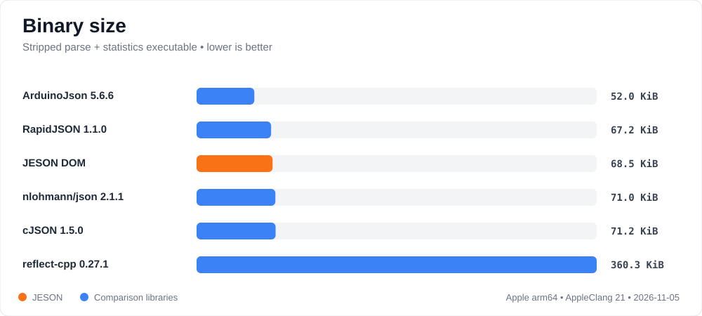
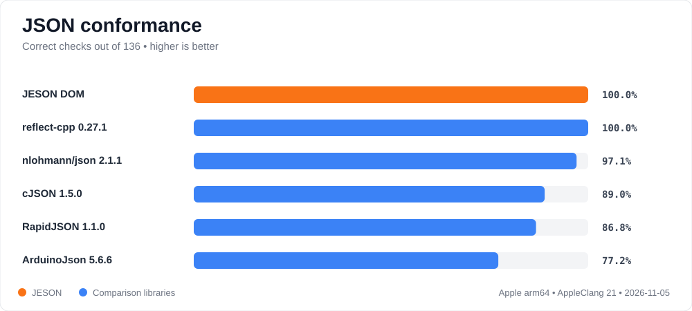
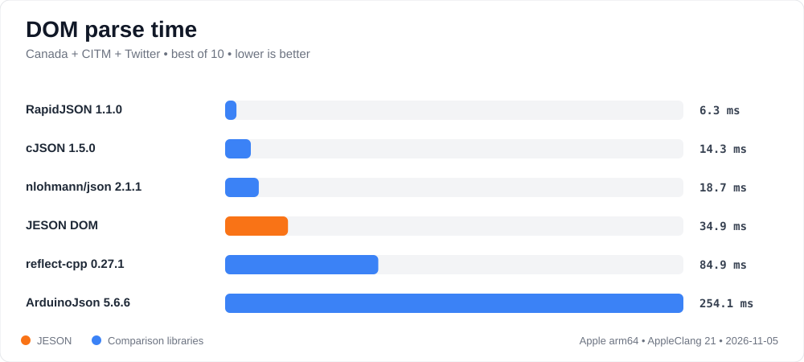
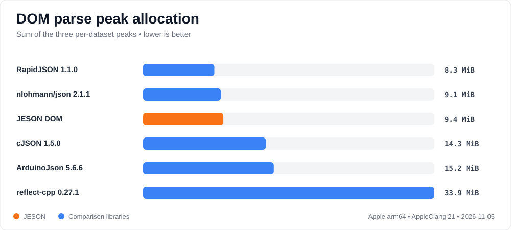
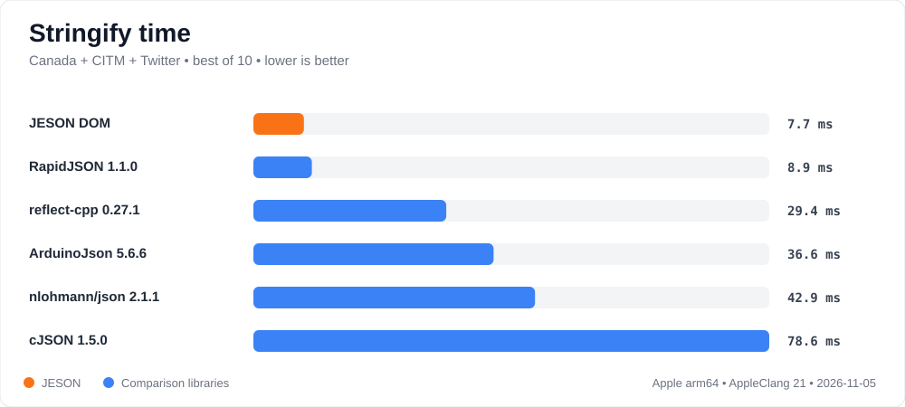
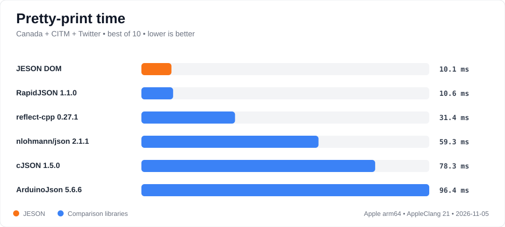

# Selected DOM benchmark: Apple arm64, 2026-11-05

This is one reproducibility sample, not a universal ranking. Lower values are
better. Each timing is the best of 10 runs from nativejson-benchmark. The build
used AppleClang 21.0.0, macOS 26.5.1 arm64, `Release`, C++20, and
`NATIVEJSON_ENABLE_NATIVE_ARCH=OFF`.

All six adapters first passed the three large-document parse/statistics
verification checks. JESON and reflect-cpp use `jeson::Value` and
`rfl::Generic`, respectively; this does not measure JESON's normal typed
direct-to-struct path.

## What this run says about JESON

JESON's optional DOM achieved full conformance, the second-lowest combined DOM
parse time, and the lowest combined stringify and pretty-print times in this
six-library run. Its stripped parse-and-statistics executable was 69,976 bytes:
close to RapidJSON and below the pinned cJSON and nlohmann/json builds. Its
summed parse peaks were also close to RapidJSON and nlohmann/json and well below
cJSON and reflect-cpp.

The optimized parser builds error paths only if an error occurs, copies the
common unescaped-string case in one operation, and starts non-empty DOM
containers with a deliberately small two-slot capacity. Against the previous
checked JESON row, combined parse time fell from 34.861 ms to 13.088 ms and
parse allocation count fell from 448,650 to 84,355. Peak live allocation was
essentially flat (9,838,800 to 9,809,776 bytes), rather than traded for speed.

RapidJSON still leads DOM parsing speed. This remains a measurement of JESON's
optional generic tree, not its normal direct-to-typed-model path.

## Visual summary

## Parse time and peak allocation

Times are milliseconds; peak allocation is the benchmark's intercepted heap
allocation in bytes. Dataset sizes are 2,251,051 bytes (Canada), 1,727,204
bytes (CITM), and 631,514 bytes (Twitter).

| Adapter | Canada ms | CITM ms | Twitter ms | Canada peak | CITM peak | Twitter peak |
|---|---:|---:|---:|---:|---:|---:|
| ArduinoJson 5.6.6 | 247.738 | 1.496 | 1.220 | 10,788,608 | 3,940,096 | 1,236,736 |
| cJSON 1.5.0 | 10.006 | 2.813 | 1.473 | 10,699,680 | 2,869,872 | 1,428,464 |
| JESON DOM | 9.524 | 2.470 | 1.094 | 6,251,568 | 2,127,248 | 1,430,960 |
| nlohmann/json 2.1.1 | 11.796 | 3.989 | 2.924 | 4,892,080 | 3,045,808 | 1,562,304 |
| RapidJSON 1.1.0 | 2.586 | 1.605 | 1.132 | 5,571,040 | 1,978,848 | 1,155,936 |
| reflect-cpp 0.27.1 JSON-only | 61.807 | 17.366 | 5.083 | 24,131,120 | 7,882,368 | 3,568,000 |

## Parse allocation count

This is the number of intercepted heap allocation calls during parsing, not
live bytes. JESON's lazy error paths and small initial container capacity make
the reduction especially visible on Canada's many coordinate arrays.

| Adapter | Canada | CITM | Twitter |
|---|---:|---:|---:|
| ArduinoJson 5.6.6 | 17 | 15 | 13 |
| cJSON 1.5.0 | 167,192 | 64,383 | 32,014 |
| JESON DOM | 58,154 | 18,309 | 7,892 |
| nlohmann/json 2.1.1 | 170,254 | 55,293 | 28,498 |
| RapidJSON 1.1.0 | 79 | 37 | 28 |
| reflect-cpp 0.27.1 JSON-only | 1,285,727 | 324,736 | 85,935 |

## Stringify and pretty-print time

| Adapter | Stringify Canada | Stringify CITM | Stringify Twitter | Pretty Canada | Pretty CITM | Pretty Twitter |
|---|---:|---:|---:|---:|---:|---:|
| ArduinoJson 5.6.6 | 25.457 | 5.866 | 5.351 | 72.213 | 15.555 | 8.611 |
| cJSON 1.5.0 | 72.805 | 4.203 | 1.122 | 72.786 | 4.309 | 1.176 |
| JESON DOM | 4.813 | 1.338 | 1.527 | 6.586 | 1.799 | 1.679 |
| nlohmann/json 2.1.1 | 37.838 | 2.907 | 1.984 | 51.470 | 5.488 | 2.343 |
| RapidJSON 1.1.0 | 7.091 | 0.836 | 0.959 | 8.439 | 1.120 | 1.055 |
| reflect-cpp 0.27.1 JSON-only | 22.227 | 5.045 | 2.150 | 24.065 | 5.281 | 2.006 |

## Conformance

The total is 136 checks: 34 syntax validation, 66 double conversion, 9 string
decoding, and 27 round trips. The figure reports correct results, not merely
inputs accepted.

| Adapter | Correct | Validation | Double | String | Round trip |
|---|---:|---:|---:|---:|---:|
| ArduinoJson 5.6.6 | 105/136 | 15/34 | 59/66 | 4/9 | 27/27 |
| cJSON 1.5.0 | 121/136 | 31/34 | 64/66 | 8/9 | 18/27 |
| JESON DOM | 136/136 | 34/34 | 66/66 | 9/9 | 27/27 |
| nlohmann/json 2.1.1 | 132/136 | 34/34 | 66/66 | 9/9 | 23/27 |
| RapidJSON 1.1.0 default precision | 118/136 | 34/34 | 48/66 | 9/9 | 27/27 |
| reflect-cpp 0.27.1 JSON-only | 136/136 | 34/34 | 66/66 | 9/9 | 27/27 |

## Binary size

Each Mach-O executable contains only the adapter plus nativejson's common
parse-and-statistics harness. Raw size is what the original suite records;
stripped size removes local symbols from a temporary copy.

| Adapter | Raw bytes | Stripped bytes |
|---|---:|---:|
| ArduinoJson 5.6.6 | 55,864 | 53,272 |
| cJSON 1.5.0 | 74,984 | 72,872 |
| JESON DOM | 85,560 | 69,976 |
| nlohmann/json 2.1.1 | 82,488 | 72,712 |
| RapidJSON 1.1.0 | 72,744 | 68,776 |
| reflect-cpp 0.27.1 JSON-only | 436,840 | 368,984 |

These desktop executable sizes are not firmware flash figures: the Apple
standard library is dynamically linked, while reflect-cpp's bundled yyjson is
linked into its executable. Repeat the same targets with the actual embedded
cross-toolchain and inspect its map/ELF file before making a device decision.

## Exact pins

- ArduinoJson `6757f35a` (`v5.6.6`)
- cJSON `8738160e` (`v1.5.0-3`)
- JESON `d51eed80` (`0.1.0-4`)
- nlohmann/json `c0d511ea` (`2.1.1`)
- RapidJSON `f54b0e47` (`v1.1.0`)
- reflect-cpp `e0ee3f6f` (`v0.27.1`), all formats off, JSON on, bundled dependencies on
