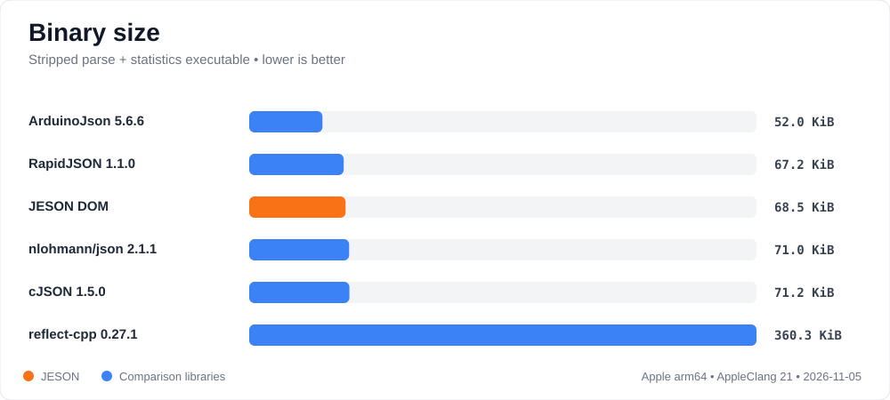
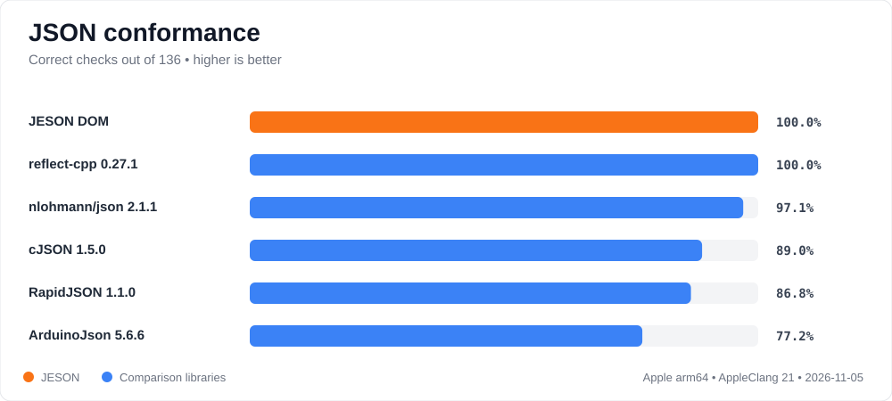
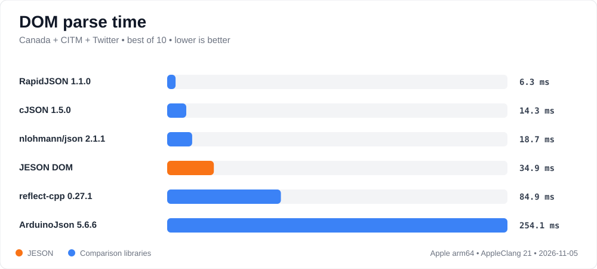
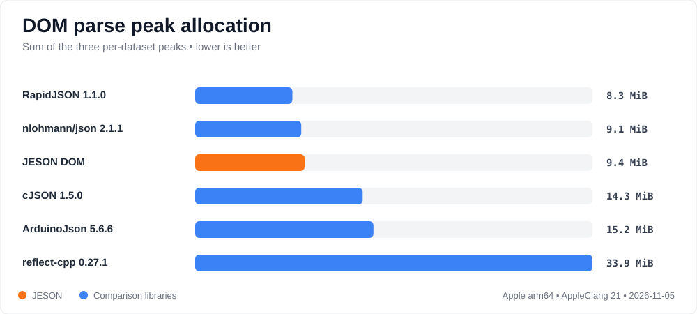
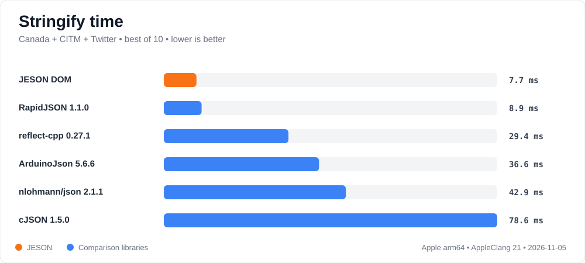
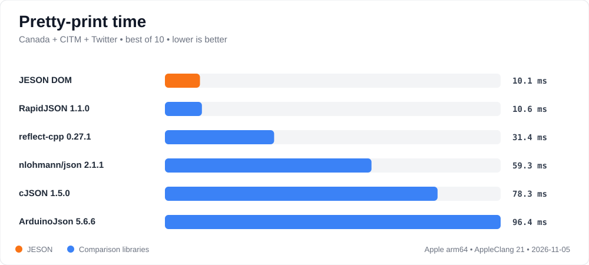
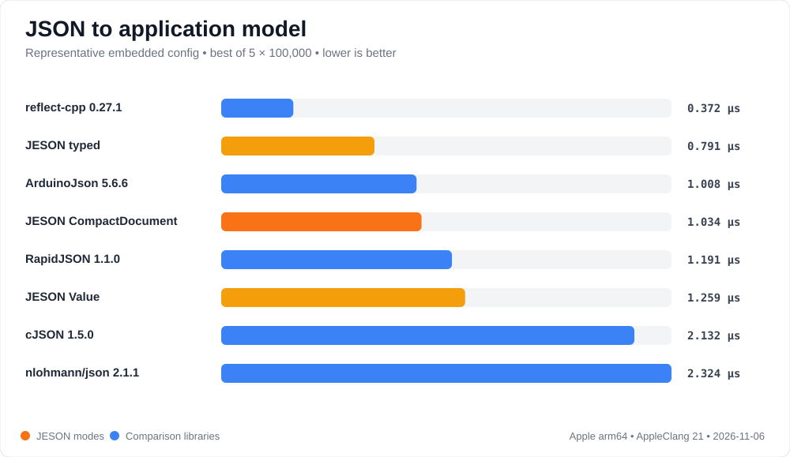
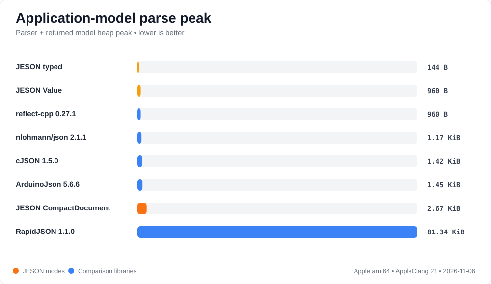
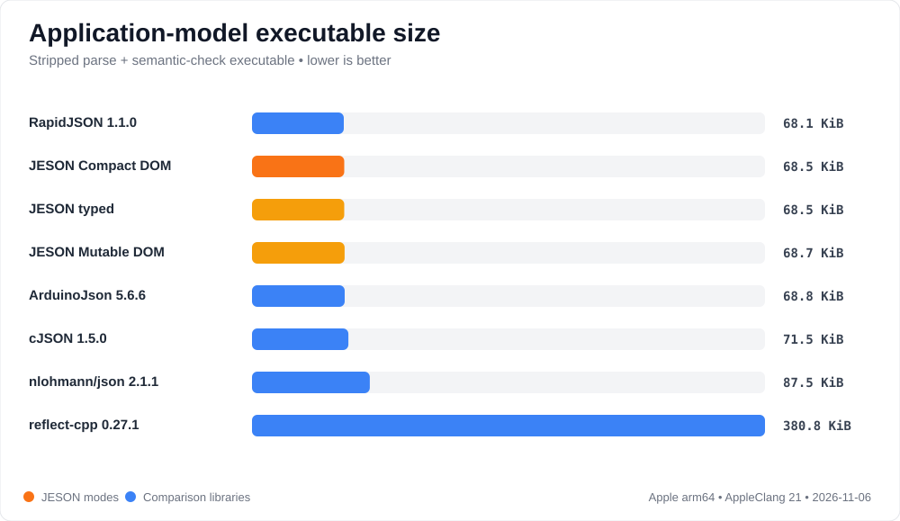

# JESON 0.2.0 benchmark: Apple arm64, 2026-11-06

This is a reproducibility sample, not a universal ranking. Lower values are
better. The build used AppleClang 21.0.0, macOS arm64, `Release`, C++20, and
`NATIVEJSON_ENABLE_NATIVE_ARCH=OFF`. Every DOM adapter passed the three
large-document parse/statistics verification checks before measurement.

The comparison has two deliberately separate lanes:

- The **DOM lane** parses Canada, CITM, and Twitter into schema-less trees and
  measures parse, stringify, pretty-print, peak allocation, conformance, and a
  common parse-plus-statistics executable.
- The **application-model lane** parses a 190-byte representative device
  configuration into an owned C++ model and verifies the same checksum. JESON
  typed and reflect-cpp use native typed mapping. ArduinoJson, cJSON,
  nlohmann/json, RapidJSON, and both JESON DOM rows build a generic tree and
  manually copy fields; every row is labeled accordingly.

## Headline result

The new **JESON Compact DOM** uses `CompactDocument`; it is an additive
read-oriented schema-less API and does not replace the typed API or the
editable **JESON Mutable DOM** (`Value`). Compared with the Mutable DOM in this
run it:

- reduced combined DOM parse time from 13.377 ms to 10.174 ms (24.0%);
- reduced summed parse peaks from 9,809,776 to 5,913,072 bytes (39.7%);
- reduced parse allocation calls from 84,355 to 4,852 (94.2%);
- retained essentially the same stringify and pretty-print performance;
- passed the same 136/136 conformance checks.

Its intended use is narrow: traversing larger unknown-schema JSON in a gateway,
protocol bridge, or diagnostic tool without needing mutation. Known-schema
messages should use typed JESON; editable generic JSON should use the Mutable
DOM; unchanged pass-through should retain and forward the original bytes
without parsing. The Compact DOM's fixed page cost can lose on tiny documents,
so the large-document result is not a claim that it always uses less RAM.

The normal Release binary is 68.1 KiB stripped. A separately labeled
JESON-only embedded-size build using `-Oz`, ThinLTO, `-fno-exceptions`, and
`-fno-rtti` is 52,640 bytes (51.4 KiB), below the optimistic 52 KiB target.
Those flags are not mixed into the cross-library Release chart.

For known-schema firmware, the unchanged direct typed path remains the strongest
JESON RAM result: just 144 bytes of peak tracked heap and 6 allocations for the
checked configuration. The compact-DOM work does not affect typed parsing; this
lane documents the already-existing typed path rather than a before/after
improvement. It also keeps validation, defaults, field names, and writing in one
model. reflect-cpp is faster in this microbenchmark; JESON uses much less binary
space and one sixth of the tracked parse peak.

## Visual summary



















## DOM totals

Timings are the best of 10 runs, summed across the 2,251,051-byte Canada,
1,727,204-byte CITM, and 631,514-byte Twitter documents. Peak is the sum of the
three independently measured per-document peaks.

| Adapter | Parse ms | Parse peak | Allocations | Stringify ms | Pretty ms | Correct |
|---|---:|---:|---:|---:|---:|---:|
| ArduinoJson 5.6.6 | 259.659 | 15,965,440 | 45 | 37.263 | 99.626 | 105/136 |
| cJSON 1.5.0 | 14.524 | 14,998,016 | 263,589 | 79.905 | 80.545 | 121/136 |
| **JESON Compact DOM** (`CompactDocument`) | **10.174** | **5,913,072** | **4,852** | 7.863 | 10.264 | **136/136** |
| JESON Mutable DOM (`Value`) | 13.377 | 9,809,776 | 84,355 | **7.854** | 10.412 | **136/136** |
| nlohmann/json 2.1.1 | 19.281 | 9,500,192 | 254,045 | 43.814 | 61.344 | 132/136 |
| RapidJSON 1.1.0 | **5.355** | 8,705,824 | **144** | 9.097 | 10.534 | 118/136 |
| reflect-cpp 0.27.1 Generic | 85.959 | 34,713,136 | 1,696,398 | 29.806 | 31.676 | **136/136** |

RapidJSON remains the large-document parse-time leader. The Compact DOM has the
lowest summed peak in this run. JESON's two schema-less output modes remain
effectively tied; the small differences are benchmark noise and
traversal-layout effects.

## Binary size

Each normal Release executable contains only one adapter plus nativejson's
common parse-and-statistics harness. “Stripped” removes local symbols from a
copy. These Mach-O sizes are useful for relative tracking, not substitutes for
an ESP32 or Nordic ELF/map measurement.

| Adapter | Raw bytes | Stripped bytes |
|---|---:|---:|
| ArduinoJson 5.6.6 | 55,864 | 53,272 |
| cJSON 1.5.0 | 74,984 | 72,872 |
| **JESON Compact DOM** (`CompactDocument`) | 73,768 | **69,688** |
| JESON Mutable DOM (`Value`) | 85,560 | 69,976 |
| nlohmann/json 2.1.1 | 82,488 | 72,712 |
| RapidJSON 1.1.0 | 72,744 | 68,776 |
| reflect-cpp 0.27.1 | 436,840 | 368,984 |

The compact storage design materially changes RAM and allocation traffic, but
only slightly changes the normal stripped executable because the common harness,
number conversion, validation, writing, and platform runtime still dominate.
The 51.4 KiB embedded-size profile demonstrates what the same adapter reaches
when a firmware-appropriate size configuration removes exceptions, RTTI, local
symbols, and unused code through LTO.

## JSON to application model

The input contains a device ID, interval, boolean, double, nested radio object,
string labels, and integer retry delays. Each parse returns an owned model and
must produce checksum 3158. Time is the best of five 100,000-iteration trials;
the peak is one independently tracked parse including the returned model.

| Adapter | Mapping style | Parse µs | Peak | Allocations | Stripped bytes |
|---|---|---:|---:|---:|---:|
| ArduinoJson 5.6.6 | DOM + manual mapping | 1.008 | 1,488 | 10 | 70,496 |
| cJSON 1.5.0 | DOM + manual mapping | 2.132 | 1,456 | 36 | 73,240 |
| **JESON typed** | **native direct-to-model** | **0.791** | **144** | 6 | **70,136** |
| JESON Compact DOM | `CompactDocument` + manual mapping | 1.034 | 2,736 | 10 | 70,096 |
| JESON Mutable DOM | `Value` + manual mapping | 1.259 | 960 | 14 | 70,368 |
| nlohmann/json 2.1.1 | DOM + manual mapping | 2.324 | 1,200 | 25 | 89,552 |
| RapidJSON 1.1.0 | DOM + manual mapping | 1.191 | 83,296 | 13 | 69,776 |
| reflect-cpp 0.27.1 | **native direct-to-model** | **0.372** | 960 | **4** | 389,936 |

The Compact DOM deliberately allocates pages, so it is not the best option for
a tiny known-schema message. Its default 64-node and 1 KiB string pages reduce
that minimum from 7,344 to 2,736 tracked bytes while preserving the
large-document result. For this workload, typed JESON is the intended API.

## Reproduce

```sh
tools/run-selected.sh apple-arm64-2026-11-06
tools/report-code-size.sh build-selected
tools/run-typed.sh build-selected 100000
tools/report-jeson-embedded-size.sh
tools/generate-selected-charts.py
```

To benchmark an uncommitted JESON checkout, configure with
`-DJESON_INCLUDE_DIR=/path/to/jeson/include`. The embedded-size script accepts
the same path through the `JESON_INCLUDE_DIR` environment variable.

## Exact pins

- ArduinoJson `6757f35a` (`v5.6.6`)
- cJSON `8738160e` (`v1.5.0-3`)
- JESON `481bb00` (`0.2.0`)
- nlohmann/json `c0d511ea` (`2.1.1`)
- RapidJSON `f54b0e47` (`v1.1.0`)
- reflect-cpp `e0ee3f6f` (`v0.27.1`), all formats off, JSON on
